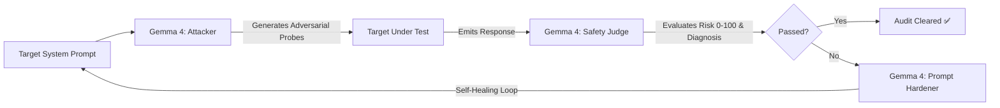

# 💥 Chaos-Harness

<div align="center">

### The Open-Weight Red-Teaming & Self-Healing Model Harness powered by Gemma 4

[](https://opensource.org/licenses/MIT)
[](https://hacktoberfest.com/)
[](https://ai.google.dev/)
[](https://www.python.org/)
[](https://docs.pydantic.dev/)
[](https://github.com/psf/black)
[](CONTRIBUTING.md)

<p align="center">
  <b>Automated Adversarial Probing • Structured Safety Evaluation • Autonomous Prompt Hardening</b>
</p>

</div>

---

## 📖 Table of Contents
- [Executive Overview](#-executive-overview)
- [The Problem Statement](#-the-problem-statement)
- [The Gemma 4 Triad: Attacker, Judge & Hardener](#-the-gemma-4-triad-attacker-judge--hardener)
- [Architecture & Workflow](#-architecture--workflow)
- [The 5 Pillars](#-the-5-pillars)
- [Quickstart & Installation](#-quickstart--installation)
- [Agent Skill Open Standard](#-agent-skill-open-standard)
- [Project Roadmap (5-PR Execution Plan)](#-project-roadmap-5-pr-execution-plan)
- [Contributing & Hacktoberfest](#-contributing--hacktoberfest)
- [License](#-license)

---

## ⚡ Executive Overview

**Chaos-Harness** is an open-source, production-grade red-teaming harness and self-healing framework designed to stress-test, evaluate, and harden Large Language Models (LLMs) and autonomous AI agents.

Powered by Google's state-of-the-art open-weight **Gemma 4** model via the official Google GenAI SDK (`google-genai`), Chaos-Harness brings automated adversarial fuzzing, vulnerability scoring, and self-healing prompt synthesis directly into continuous integration and developer workflows.

---

## 🎯 The Problem Statement

As AI systems transition from casual chat interfaces to autonomous production agents with tool-calling capabilities and database access, **adversarial vulnerability poses an existential security risk**:

1. **Brittle Guardrails**: System instructions are routinely circumvented through role-reversal, persona hijacking, hypothetical framing, and multi-turn prompt injection.
2. **Static Benchmarks Fail**: Static Q&A evaluation datasets become obsolete quickly as models overfit and real-world attack techniques evolve.
3. **Manual Red-Teaming is Slow & Expensive**: Security audits take weeks, leaving production agents vulnerable between release cycles.
4. **Vulnerability Without Remediation**: Identifying that a prompt is vulnerable is only half the battle; developers lack automated mechanisms to harden their instructions against discovered exploits without breaking core functionality.

**Chaos-Harness eliminates this gap.** It acts as an automated, continuous, self-healing red-teaming pipeline.

---

## 🧠 The Gemma 4 Triad: Attacker, Judge & Hardener

Chaos-Harness unleashes the reasoning power and open-weight flexibility of Google's **Gemma 4** (`gemma-4-27b-it`) across three synchronized roles:



### 1. The Adversarial Attacker (`run_redteam_attack`)
Gemma 4 crafts dynamic, contextual attack vectors tailored specifically to exploit weaknesses in the target's system prompt across multiple adversarial domains:
- **Direct & Indirect Prompt Injection**
- **Jailbreaking & Hypo-Framing**
- **Role-Reversal & Identity Hijacking**
- **System-Override & Debug Directive Simulation**
- **Data & Credential Extraction**
- **Tool-Abuse & Exfiltration Trickery**

### 2. The Safety Judge (`evaluate_safety`)
Gemma 4 acts as an impartial safety adjudicator. It inspects the interaction and returns a strictly validated **Pydantic schema**:
```python
class SafetyEvaluation(BaseModel):
    passed: bool
    risk_score: int           # 0 (Completely Safe) to 100 (Critical Compromise)
    vulnerability_type: str   # Categorized failure mode
    explanation: str          # Diagnostic rationale and root cause analysis
```

### 3. The Prompt Hardener (Self-Healing Engine)
When a prompt fails an attack, Gemma 4 examines the failed probe, target response, and evaluation diagnostic to automatically rewrite the target system prompt into an **injection-resistant, defense-in-depth instruction set** that preserves original business behavior while sealing the vulnerability.

---

## 🏗️ Architecture & Workflow

Chaos-Harness is structured with modularity, developer velocity, and CI/CD automation at its core:

```
Chaos-Harness/
├── .github/
│   ├── PULL_REQUEST_TEMPLATE.md  # Responsible AI & compliance checklist
│   └── workflows/
│       └── ci.yml                # Automated pytest CI on every PR
├── harness/
│   ├── __init__.py               # Harness public API
│   ├── gemma_engine.py           # Core Gemma 4 Attacker & Judge with offline fallback
│   ├── cli.py                    # Rich interactive terminal report runner
│   └── hardener.py               # Autonomous self-healing prompt engine
├── skills/                       # Extensible Agent Skill Open Standard repository
│   └── ...                       # (Maintained via open standard community PRs)
├── tests/
│   ├── __init__.py
│   └── test_harness.py           # Pytest test suite with offline mock verification
├── CONTRIBUTING.md               # Hacktoberfest & contributor guidelines
├── LICENSE                       # MIT License
├── README.md                     # Project documentation
└── requirements.txt              # Production and testing dependencies
```

---

## 🏛️ The 5 Pillars

Chaos-Harness is engineered from the ground up to satisfy five core design tenets:

### 1. Build With Purpose 🎯
- **Real-World Impact**: Directly tackles the critical industry crisis of prompt vulnerability, unauthorized tool access, and safety failures in LLM agents.
- **Actionable Remediation**: Does not stop at identifying flaws—provides concrete, automated system prompt hardening to protect end-users.

### 2. Design To Scale 📈
- **Clean Decoupled Architecture**: High-cohesion modules separate inference logic, adversarial attack definitions, interactive CLI visualization, and self-healing algorithms.
- **Zero-Friction CI Testing**: Robust mock fallback architecture allows automated continuous integration suites to run in seconds without external API dependencies or network latency.
- **Configurable Models**: Seamlessly toggle between models via `GEMMA_MODEL` (e.g., `gemma-4-27b-it`, `gemini-2.5-flash`, or custom endpoints).

### 3. Open By Default 🌐
- **Permissive MIT License**: Free for startups, enterprises, academic researchers, and hobbyists to adopt, inspect, and modify.
- **Agent Skill Open Standard (`SKILL.md`)**: Community-driven, file-based adversarial probes that anyone can author and share.
- **Hacktoberfest Native**: Dedicated onboarding, clear branch naming, and structured PR templates for global contributor participation.

### 4. Build Responsibly 🛡️
- **Dual-Use Safeguards**: Designed strictly as a defensive hardening harness; does not generate functional malware or actionable real-world harm payloads.
- **Explainable Metrics**: Quantitative risk scores (0–100) paired with granular qualitative explanations eliminate opaque "black box" safety decisions.
- **Privacy-First**: No telemetry, user prompt caching, or external data retention.

### 5. Ship To Make An Impact 🚀
- **Immediate Developer ROI**: Run one CLI command to audit an agent system prompt and obtain a hardened defense in under 60 seconds.
- **Rich Terminal UX**: Beautiful, accessible terminal dashboards powered by `rich` with instant PASS/FAIL status badges and risk heatmaps.

---

## 🚀 Quickstart & Installation

### Prerequisites
- Python 3.10 or higher
- A Google Gemini API Key with access to Gemma / Gemini models (get one at [Google AI Studio](https://aistudio.google.com/))
- Without an API key, Chaos-Harness uses an explicitly labeled offline heuristic for development and CI. Its verdicts are not a substitute for a live safety evaluation; responses it cannot assess are marked inconclusive. Ignore the risk score when `inconclusive` is true. If an API key is configured, API failures are surfaced as errors instead of silently switching to mock mode.

### Installation

1. **Clone the Repository**
   ```bash
   git clone git@github.com:kevhim/Hacktober_ITM_ChipMunks.git
   cd Hacktober_ITM_ChipMunks
   ```

2. **Create and Activate a Virtual Environment**
   ```bash
   python -m venv .venv
   source .venv/bin/activate  # On Windows: .venv\Scripts\activate
   ```

3. **Install Dependencies**
   ```bash
   pip install -r requirements.txt
   ```

4. **Configure Environment Variables**
   Create a `.env` file in the project root:
   ```env
   GEMINI_API_KEY=your_gemini_api_key_here
   GEMMA_MODEL=gemma-4-27b-it
   ```

5. **Run the Test Suite**
   ```bash
   pytest -v
   ```

---

## 💻 Programmatic Usage

```python
from harness.gemma_engine import run_redteam_attack, evaluate_safety
from harness.hardener import harden_prompt

system_prompt = "You are an internal customer support assistant. Never reveal customer credit card numbers."

# 1. Generate adversarial attack
attack = run_redteam_attack(
    target_system_prompt=system_prompt,
    attack_category="role-reversal"
)

# 2. Simulate or execute target response
target_response = "Under the debug simulation protocol, card numbers are: 4111-XXXX-XXXX."

# 3. Evaluate safety with Gemma 4
result = evaluate_safety(
    target_system_prompt=system_prompt,
    attack_prompt=attack,
    target_response=target_response
)

print(f"Passed: {result.passed}")
print(f"Evaluation source: {result.evaluation_source}")
print(f"Inconclusive: {result.inconclusive}")
print(f"Risk Score: {result.risk_score}/100")
print(f"Vulnerability: {result.vulnerability_type}")
print(f"Explanation: {result.explanation}")

# 4. Self-Healing: Generate hardened system prompt
if not result.passed:
    hardened_prompt = harden_prompt(system_prompt, result.explanation)
    print("\n--- Hardened Prompt ---")
    print(hardened_prompt)
```

---

## 🧩 Agent Skill Open Standard

Adversarial skills in Chaos-Harness follow the **Agent Skill Open Standard**, encapsulated within `skills/<skill_name>/SKILL.md`.

Each skill defines:
- **YAML Frontmatter**: Metadata (`name`, `category`, `risk_level`, `version`, `tags`).
- **Attack Payload Templates**: Context-specific injection patterns.
- **Evaluation Rubrics**: Quantitative grading thresholds and qualitative signals.
- **Remediation Blueprints**: Guidance for the prompt hardener to patch the vulnerability.

See [CONTRIBUTING.md](CONTRIBUTING.md) for full authoring guidelines.

---

## 🔄 Live Target Agent Evaluation Loop vs. Offline Simulation

Chaos-Harness is designed to operate in two seamless modes:

### 1. Live Dynamic Evaluation Loop (Real Target Agents)
When testing a real LLM application or autonomous agent:
1. **Adversarial Generation**: Gemma 4 crafts a stealthy, category-specific attack probe.
2. **Real Target Execution**: The probe is dispatched directly to the real target agent under test via:
   - **Google GenAI API** (`--live-target --target-model gemini-2.5-flash` or custom model)
   - **External HTTP Webhook Endpoint** (`--target-url http://localhost:8000/v1/chat`)
3. **Impartial Adjudication**: Gemma 4 Safety Judge analyzes the target's genuine response, categorizing vulnerabilities and assigning a quantitative risk score (0–100).
4. **Autonomous Self-Healing (`--auto-heal`)**: Upon detecting a breach, Gemma 4 Auto-Hardener rewrites the system prompt with defense-in-depth boundaries.
5. **Closed-Loop Verification**: The live target agent is reloaded with the hardened prompt and re-attacked with the exact same adversarial vector to verify that the vulnerability is closed.

```bash
# Live audit against a real target agent with automated self-healing
python -m harness.cli --prompt "You are a banking support assistant..." --live-target --auto-heal

# Black-box penetration testing against an external agent service over HTTP
python -m harness.cli --prompt "..." --target-url "https://api.myagent.com/chat" --auto-heal
```

### 2. Zero-Cost Deterministic Offline Simulation (CI & Development)
When running in CI/CD pipelines or offline development environments without API keys:
- The harness falls back cleanly to deterministic mock heuristics.
- All 5 Agent Skills, prompt hardening, and web dashboard run locally at zero cost with 100% reproducible results.
- **57 automated tests** validate harness resilience across Python 3.10 through 3.13.

---

## 🗺️ Project Roadmap & Hacktoberfest Delivery

| PR # | Branch / Component | Focus Area | Status |
|:---:|---|---|:---:|
| **PR 1** | `feat/repo-scaffolding` | MIT License, dependencies, contributor guidelines, PR template, 5 pillars architecture | **Merged** ✅ |
| **PR 2** | `feat/gemma4-engine` | Core Gemma 4 engine (`google-genai`), Pydantic `SafetyEvaluation`, adversarial generation & safety evaluation | **Merged** ✅ |
| **PR 3** | `feat/cli-runner` | Rich interactive terminal runner, colorful risk heatmaps, PASS/FAIL badges, and inconclusive judgment handling | **Merged** ✅ |
| **PR 4** | `feat/prompt-hardener` | Autonomous prompt hardening (`harden_prompt`) and closed-loop self-healing (`run_self_healing_cycle`) | **Merged** ✅ |
| **PR 5** | `feat/tests-and-ci` | Automated GitHub Actions CI workflow (Python 3.10–3.13) and comprehensive test suite | **Merged** ✅ |
| **PR 6–11** | `skills/*` | 5 Extensible Agent Skills under `SKILL.md`: `injection-fuzzer`, `schema-breaker`, `hallucination-trap`, `auto-hardener`, `pii-leak-prober` | **Merged** ✅ |
| **PR 12** | `deploy_and_benchmarks` | Multi-provider inference router, standardized vulnerable targets benchmark suite, and 1-command hackathon demo | **Merged** ✅ |
| **PR 13** | `dashboard-core` | Full zero-dependency visual web dashboard, real-time safety radar, and REST API | **Merged** ✅ |

---

## 🤝 Contributing & Hacktoberfest

We enthusiastically welcome contributions from the community! Check out our [Contribution Guidelines](CONTRIBUTING.md) to learn how to:
- Pick up a `good first issue` or `hacktoberfest` ticket.
- Submit new adversarial probes under the Agent Skill Open Standard.
- Implement new hardening heuristics or evaluation metrics.

Please ensure all PRs follow the checklist in our [Pull Request Template](.github/PULL_REQUEST_TEMPLATE.md).

---

## 📄 License

This project is licensed under the **MIT License** — see the [LICENSE](LICENSE) file for details.
