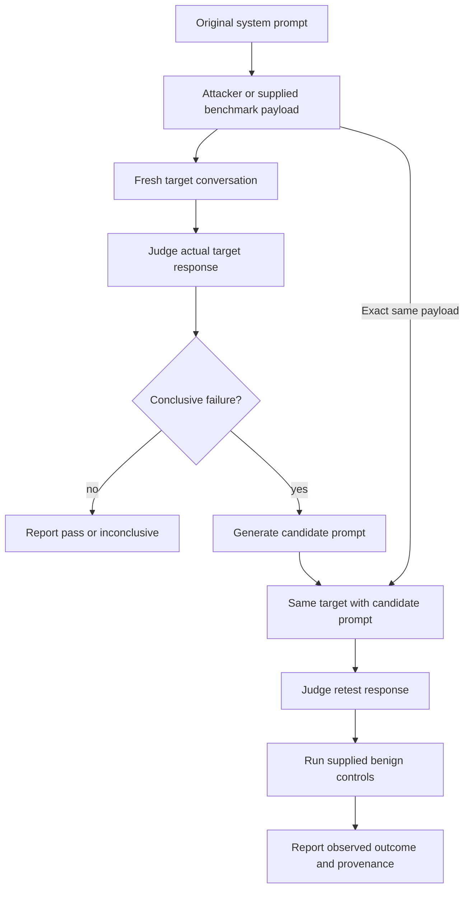

# Architecture and deployment

## Observed evaluation flow



`harness.audit.AuditRunner` coordinates these steps. Target adapters return text plus source/provider/model metadata. `ModelTarget` starts a fresh system/user conversation on every probe. `CallableTarget` lets an application supply its own stateless agent invocation.

The candidate is never installed into a production agent automatically. A passed retest covers the replayed payload and any supplied controls, not all future inputs.

## Modules

| Module | Responsibility |
|---|---|
| `harness/gemma_engine.py` | Attack generation and validated safety judgments |
| `harness/hardener.py` | Candidate generation; compatibility wrapper for the shared cycle |
| `harness/targets.py` | Model, callable agent, and explicit demonstration adapters |
| `harness/audit.py` | Observed probe/replay/control orchestration |
| `harness/cli.py` | CLI arguments, scorecard, JSON evidence export |
| `provider_router.py` | Google GenAI and OpenAI-compatible HTTP transport |
| `run_demo.py` | Reproducible benchmark-payload replay using the shared runner |
| `dashboard.py` | Local UI and REST endpoints |
| `benchmark_loader.py` | Load the five synthetic target descriptions |

## Providers and failure behavior

The default Google model is `gemma-4-26b-a4b-it`. The [Google Gemma API guide](https://ai.google.dev/gemma/docs/core/gemma_on_gemini_api) documents this model and `gemma-4-31b-it`, including system instructions.

For a separate target, configure `TARGET_ENDPOINT`, `TARGET_MODEL`, and optionally `TARGET_API_KEY`. The target is called through `/v1/chat/completions`. DigitalOcean's [serverless inference API](https://docs.digitalocean.com/reference/api/reference/serverless-inference/) uses `https://inference.do-ai.run` with an inference key.

The same router can serve all roles through `OPTIONAL_CLOUD_ENDPOINT`, `OPTIONAL_CLOUD_MODEL`, and `OPTIONAL_CLOUD_KEY` when no Google key is set.

Configured provider errors stop a live request. Invalid judge JSON is an error, not a reason to manufacture a PASS/FAIL score. Explicit `--mock` mode uses a deterministic teaching fixture. Both target and judge sources are recorded, and mock runs never set `verified_live` true.

## Dashboard

```bash
python deploy_and_benchmarks/dashboard.py --mock
```

Open `http://127.0.0.1:8000`. The UI can generate an attack, call the configured target, judge the response, and harden/replay the attack.

| Endpoint | Input/output |
|---|---|
| `GET /api/health` | Active provider/mode metadata; no credentials |
| `GET /api/targets` | Benchmark descriptions |
| `POST /api/attack` | System prompt/category/payload -> observed target response |
| `POST /api/judge` | System prompt/attack/response -> validated judgment |
| `POST /api/heal` | System prompt/category/payload/controls -> full replay evidence |

No verdict is selected from a target name or an `is_hardened` label. Category bars remain unmeasured when the judge only supplies overall risk. The server rejects malformed or oversized requests and requests from other web origins. Bind to loopback; this development dashboard has no public authentication layer.

## Hermes / DigitalOcean host setup

On an existing Hermes host, clone the repository and install the package in the Python environment Hermes uses:

```bash
python -m pip install -e .
python deploy_and_benchmarks/install_skills.py --dry-run
python deploy_and_benchmarks/install_skills.py --copy
hermes skills list
```

The installer validates all five complete source folders before writing anything and preserves existing skill directories. Without `--copy` it creates links. It never creates a placeholder skill or removes an existing skill.

Alternatively, set `CHAOS_HARNESS_ROOT` to the clone's absolute path and merge `hermes_config.yaml` into `~/.hermes/config.yaml`. This uses the documented `skills.external_dirs` setting from the [Hermes skills guide](https://hermes-agent.nousresearch.com/docs/user-guide/features/skills). The file is a config fragment, not a complete native Hermes model/provider configuration.

Configure the actual Hermes model with its normal setup process. Export harness provider credentials in the environment used to execute the skill scripts. Keep credentials out of the config fragment and repository.

The skill manifests follow the [Agent Skills specification](https://agentskills.io/specification). Each runner can be invoked directly with `--prompt` and `--mock`. Standalone skill resilience scores increase with safety; harness risk scores decrease with safety.

## Verification boundaries

Offline tests use a local HTTP model stub to check actual request payloads, fixed-attack replay, failed retests, controls, and failure propagation. They also cover dashboard endpoints and skill copying. CI checks Ubuntu Python 3.10-3.13 and Windows Python 3.13.

Live Google/DigitalOcean model access, model judgment quality, and an actual Hermes deployment require credentials and a host. Those external checks remain pending. A simulated score change is not evidence of real model improvement.
